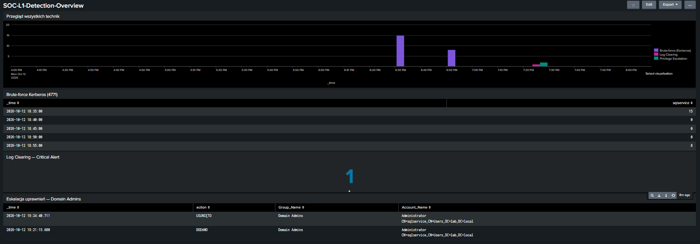

# Domainwatch

Home-lab środowisko Active Directory + Splunk SIEM, zbudowane do symulacji i wykrywania technik ataku zmapowanych na MITRE ATT&CK. Projekt portfolio pod rekrutację na stanowisko SOC L1.

## Architektura

- **DC01** — Windows Server 2022, kontroler domeny (`lab.local`)
- **Sysmon** — telemetria procesów na DC01, konfiguracja modularna (redukcja szumu)
- **Splunk Enterprise** — self-hosted SIEM na dedykowanej maszynie Ubuntu Server
- **Splunk Universal Forwarder** — przesył logów Security + Sysmon w czasie rzeczywistym (TCP 9997)


## Zaimplementowane techniki

| Technika | MITRE ATT&CK | Event ID | Plik |
|---|---|---|---|
| Kerberoasting | T1558.003 | 4769 | `detections/kerberoasting.spl` |
| Obfuscated PowerShell | T1059.001 | Sysmon EID 1 | `detections/obfuscated-powershell.spl` |
| Kerberos Brute-force | T1110 | 4771 | `detections/kerberos-bruteforce.spl` |
| Privilege Escalation | T1098 | 4728/4729/4732/4756 | `detections/privilege-escalation.spl` |
| Log Clearing | T1070.001 | 1102 | `detections/log-clearing.spl` |

Dla Kerberoastingu i Obfuscated PowerShell dodatkowo reguły w formacie Sigma (`sigma-rules/`) — detekcja niezależna od konkretnego SIEM.

## Przykład: Kerberoasting (T1558.003)

**Symulacja ataku:** konto serwisowe `sqlservice` ze skonfigurowanym SPN, wymuszone żądanie biletu TGS z szyfrowaniem RC4 (słabym względem AES).

**Detekcja (SPL):**
```spl
index=main EventCode=4769 Ticket_Encryption_Type=0x17
NOT Account_Name="*$"
| table _time, Account_Name, Service_Name, Ticket_Encryption_Type
```

**Dlaczego to działa:** żądanie TGS z `Ticket_Encryption_Type=0x17` (RC4) dla konta z ustawionym SPN jest nietypowe w środowisku preferującym AES — atakujący zazwyczaj wymusza słabsze szyfrowanie, żeby ułatwić sobie offline cracking bileta.

## Dashboard

Panel zbiorczy w Splunku, agregujący wszystkie pięć detekcji na jednej osi czasu, plus osobne panele dla brute-force, eskalacji uprawnień i log clearingu.



## Czego się nauczyłem / ograniczenia projektu

- **Kerberos vs NTLM przy failed logon:** próba logowania po nazwie hosta wymusza Kerberos; błędne hasło generuje Event ID 4771 (nie 4625, który dotyczy NTLM/logowania interaktywnego).
- **Próg detekcji nieskalibrowany:** próg agregacji (≥5 prób / 2 min) dobrany konserwatywnie, bez baseline'u realnego ruchu — w produkcyjnym środowisku wymagałby kalibracji na danych historycznych.
- **Ograniczenie testowe:** atak symulowany z poziomu samego kontrolera domeny (`Client_Address: ::1`), nie z osobnej maszyny klienckiej — brak pełnej telemetrii sieciowej, docelowo do powtórzenia z oddzielnego hosta.
- **Pola multivalue w Windows Event Log:** np. `Account_Name` w evencie 4728 zawiera zarówno wykonawcę akcji, jak i obiekt zmiany — wymaga świadomego filtrowania, inaczej detekcja łapie fałszywe dopasowania.

## Struktura repozytorium

```
detections/     — zapytania SPL dla każdej techniki
sigma-rules/     — reguły Sigma (vendor-neutral)
dashboard/       — zrzut ekranu dashboardu Splunk
architecture/    — diagram architektury
docs/            — szczegółowy opis symulacji ataków
