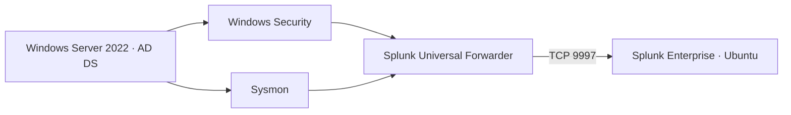
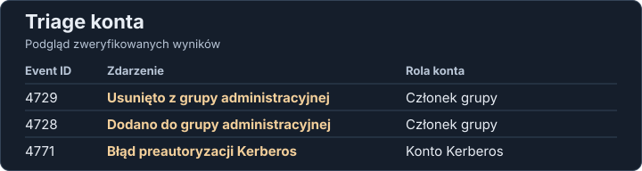
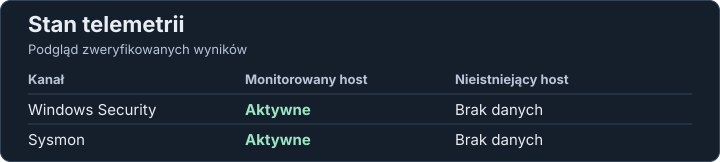

# DomainWatch

Lab SOC do analizy zdarzeń Active Directory w Splunk Enterprise. Zbieram logi Windows Security i Sysmon, piszę detekcje w SPL i sprawdzam, jak ich wyniki pomagają w triage’u. Reguły Kerberos i zmian grup zweryfikowałem na historycznych logach labu oraz syntetycznych przypadkach w Splunku.

**Zacznij od [studium przypadku Kerberos](docs/case-kerberos-triage.md)**. Szczegółowa reguła zwróciła 15 pasujących okien. Dashboard połączył je w dwie serie do sprawdzenia, zachowując dostęp do wyników szczegółowych.

## Architektura

## Od detekcji do triage’u

**Triage konta** pokazuje błędy Kerberos i zmiany grup na wspólnej osi czasu. Zmiany grup można filtrować po wykonawcy lub po SID członka. Powiązanie wydania TGT z wcześniejszym błędem zweryfikowałem osobno na danych syntetycznych. [Instrukcja triage](docs/account-triage.md)

**Stan telemetrii** pomaga sprawdzić, czy brak trafień może wynikać z przerwy w dostawie logów. Panel pokazuje czas ostatniego zdarzenia osobno od czasu indeksowania. [Instrukcja panelu](docs/telemetry-health.md)

Podglądy odtwarzają zweryfikowane wyniki. Pomijają nazwy kont i hostów, SID-y oraz dokładne znaczniki czasu.

## Detekcje

| Sygnał | Zdarzenia | Reguła |
|---|---|---|
| Seria błędów Kerberos dla jednego konta | Security 4771 | [SPL](detections/kerberos-bruteforce.spl) · [weryfikacja i triage](docs/kerberos-bruteforce.md) |
| Podejrzenie password sprayingu | Security 4771 | [SPL](detections/kerberos-password-spray.spl) · [weryfikacja i triage](docs/kerberos-password-spray.md) |
| Zmiany członkostwa w grupach administracyjnych | Security 4728, 4729, 4732, 4733, 4756, 4757 | [SPL](detections/privilege-escalation.spl) · [weryfikacja i triage](docs/privileged-group-changes.md) |
| Bilety usługowe Kerberos z RC4 | Security 4769 | [SPL](detections/kerberoasting.spl) · [Sigma](sigma-rules/kerberoasting.yml) |
| PowerShell z zakodowanym poleceniem lub ukrytym oknem | Sysmon 1 | [SPL](detections/obfuscated-powershell.spl) · [Sigma](sigma-rules/obfuscated-powershell.yml) |
| Wyczyszczenie dziennika Security | Security 1102 | [SPL](detections/log-clearing.spl) |

Pliki [Classic XML](dashboard/) można zaimportować do Splunk Web. Katalog [tests](tests/) zawiera generatory zapytań, które tworzą zdarzenia syntetyczne na czas wyszukiwania.

## Zakres labu

Lab obejmuje jeden kontroler domeny. Analizowane serie Kerberos pochodziły z jego interfejsu lokalnego (`::1`). Progi detekcji są ustawieniami labowymi i wymagają kalibracji na ruchu właściwym dla wdrożenia. Panele służą do ręcznego triage’u w Splunk Web.
